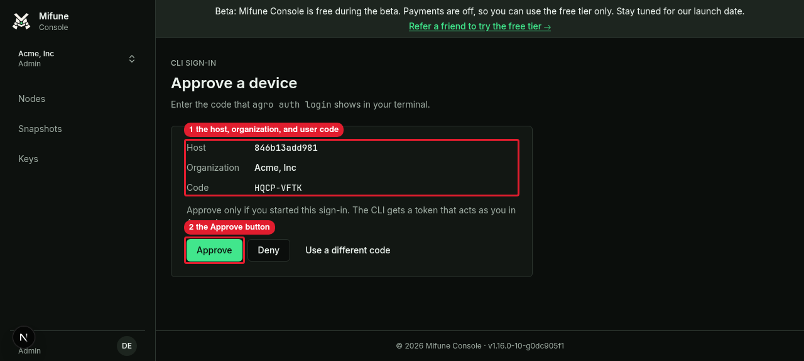
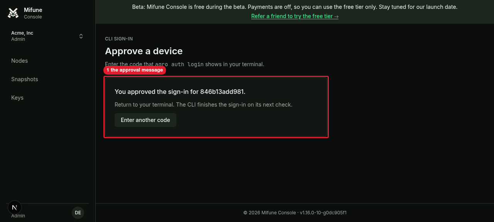

# US-009 manual review: console CLI sign-in

This file records the manual review of US-009. Part 1 runs against a local
console dev server. Part 2 runs against `https://console.mifune.dev`.

Each output block is a copy of an observed run on 2026-10-16. Each block is
trimmed to the lines that matter. Every `agro` command also prints this
sandbox warning on stderr. The blocks leave out the warning:

```text
agro: warning: /etc/agro/sandbox is missing; detected the sandbox from /.dockerenv and SANDBOX_NAME. Upgrade the sandbox image.
```

No block holds a full token value. Each `mfc_` string in this file is the
12-character token prefix.

## Part 1: local console

**Prerequisites**

- The console dev server runs at `http://127.0.0.1:3448`. The footer shows the
  version `v1.16.0-10-g0dc905f1`.
- The server uses a scratch database and the dev sign-in of
  `apps/web/lib/dev-login.ts`. The user `dev@agro.local` is an admin in the
  organization `Acme, Inc`.
- The CLI under test is the built bundle `.agro/cli/dist/agro.js` at commit
  `b030aa034eb98fe193427041ddfd0abbc473ce90`. Node is `v22.23.3`.
- All commands run in the sandbox, local. The sandbox host name is
  `846b13add981`.

**Setup (sandbox, local)**

1. Isolate the credentials file from the operator file. Run these commands in
   the shell that runs each `agro` command:

   ```bash
   unset AGRO_CONSOLE_TOKEN AGRO_CONSOLE_URL
   export XDG_CONFIG_HOME=<scratch directory>/us009-xdg
   alias agro='node .agro/cli/dist/agro.js'
   ```

   Expected: `agro` writes the credentials file at
   `$XDG_CONFIG_HOME/agro/console.json`.

**A. Sign in with the device flow**

1. Start the sign-in. Run the command in a named tmux session, because the
   command waits for the browser approval:

   ```bash
   agro auth login --url http://127.0.0.1:3448
   ```

   Output before the approval:

   ```text
   Open http://127.0.0.1:3448/device and enter the code HQCP-VFTK
   Waiting for approval...
   ```

2. In agent-browser, open `http://127.0.0.1:3448/device`. The console sends
   the browser to `/signin`. Sign in with the dev sign-in as `dev@agro.local`.

3. Open `http://127.0.0.1:3448/device` again. Enter `HQCP-VFTK` in the field
   "Code from your terminal". Click "Continue".
   Expected: the page "Approve a device" shows "Host" `846b13add981`,
   "Organization" "Acme, Inc", and "Code" `HQCP-VFTK`. The page shows the
   buttons "Approve", "Deny", and "Use a different code".
   <details><summary>Screenshot</summary>

   
   </details>
   Callouts: 1 is the host, organization, and user code. 2 is the Approve button.

4. Click "Approve".
   Expected: the page shows "You approved the sign-in for 846b13add981." and
   "Return to your terminal. The CLI finishes the sign-in on its next check."
   <details><summary>Screenshot</summary>

   
   </details>
   Callouts: 1 is the approval message.

5. Read the output of the `agro auth login` command from step 1.
   Output after the approval:

   ```text
   logged in to http://127.0.0.1:3448 as dev
   ```

   Observed exit status: 0.

**B. Read the sign-in state**

Prerequisites: scenario A is complete.

1. Show the sign-in state:

   ```bash
   agro auth status
   ```

   Output:

   ```text
   url: http://127.0.0.1:3448
   login: dev
   role: admin
   org: 6487381c-e80c-4c2c-96a1-5f66d81fb4eb
   source: file
   token prefix: mfc_lbRP2Hcf
   ```

   Observed exit status: 0. The `org` line shows the organization id, not the
   name "Acme, Inc".

2. Print the first 12 characters of the token:

   ```bash
   agro auth token | cut -c1-12
   ```

   Output:

   ```text
   mfc_lbRP2Hcf
   ```

   Observed exit status of `agro auth token`: 0. The prefix is the same as
   the `token prefix` line of step 1.

3. Show the mode of the credentials file. Do not print the file:

   ```bash
   stat -c %a "$XDG_CONFIG_HOME/agro/console.json"
   ```

   Output:

   ```text
   600
   ```

   Observed exit status: 0.

**C. Sign out**

Prerequisites: scenario B is complete.

1. Sign out:

   ```bash
   agro auth logout
   ```

   Output:

   ```text
   logged out of http://127.0.0.1:3448
   ```

   Observed exit status: 0.

2. Test for the credentials file:

   ```bash
   test -e "$XDG_CONFIG_HOME/agro/console.json"
   ```

   Observed exit status: 1.

3. Failure path. Show the sign-in state after the sign-out:

   ```bash
   agro auth status
   ```

   Output:

   ```text
   not logged in to agro-console: run agro auth login
   ```

   Observed exit status: 1.

4. Failure path. Print the token after the sign-out:

   ```bash
   agro auth token
   ```

   Output:

   ```text
   not logged in to agro-console: run agro auth login
   ```

   Observed exit status: 1.

**D. Cleanup**

1. Close the agent-browser session.
2. Delete the `us009-xdg` scratch directory.

Expected: no credentials file from the review remains.

## Part 2: production console

Status: done on 2026-10-17 against agro-console v1.17.0 at
`https://console.mifune.dev`. The operator approved the run and approved each
user code in the browser. The review built the CLI under test, `.agro/cli/dist/agro.js`,
from `feat/1448-console-auth`. Each command ran with `XDG_CONFIG_HOME` set to a
scratch directory, with `AGRO_CONSOLE_TOKEN` and `AGRO_CONSOLE_URL` unset.

**A. First attempt: team org context**

The operator approved code `DDTM-RBPX` while a team org was the active context.
Login, status, and the token prefix worked. The free-tier create failed:

```text
$ agro node create --free-tier --name agro-review-1448
agro node create: HTTP 403 FREE_TIER_INELIGIBLE: Only the owner of a personal context can create a free node
exit=1
```

The console free tier accepts only a personal context. The CLI passed the SSH
key step and reached `POST /api/nodes`. The review then ran `agro auth logout`
and started again.

**B. Login in the personal context**

```text
$ agro auth login
Open https://console.mifune.dev/device and enter the code WNTR-HVFM
Waiting for approval...
logged in to https://console.mifune.dev as ryaneggz
exit=0

$ agro auth status
token prefix: mfc_Dw09hHTI
exit=0
```

**C. Node create with no key flag**

```text
$ agro node create --free-tier --name agro-review-1448
agro node create: node 76ad27e1-578b-4a22-b502-90336e78e519 queued
agro node create: node 76ad27e1-578b-4a22-b502-90336e78e519 bootstrapping
agro node create: node 76ad27e1-578b-4a22-b502-90336e78e519 running
id: 76ad27e1-578b-4a22-b502-90336e78e519
status: running
ssh sandbox@40.160.99.61
exit=0

$ ssh sandbox@40.160.99.61 hostname
76ad27e1-578b-4a22-b502-90336e78e519
exit=0
```

The SSH login used only the key that `agro node create` found or registered.

**D. List and delete**

```text
$ agro node list
ID                                    NAME              PROFILE  STATUS   IPV4
76ad27e1-578b-4a22-b502-90336e78e519  agro-review-1448  sandbox  running  40.160.99.61

$ agro node delete 76ad27e1-578b-4a22-b502-90336e78e519 --yes
deleted 76ad27e1-578b-4a22-b502-90336e78e519
exit=0
```

The node reached the status `destroyed` within 180 seconds.

**E. No live node, then logout**

```text
$ agro node list   # rows other than destroyed
ID                                    NAME              PROFILE  STATUS     IPV4

$ agro auth logout
logged out of https://console.mifune.dev
exit=0

$ agro auth status
not logged in to agro-console: run agro auth login
exit=1
```

The review deleted the scratch credentials directory after the logout.
