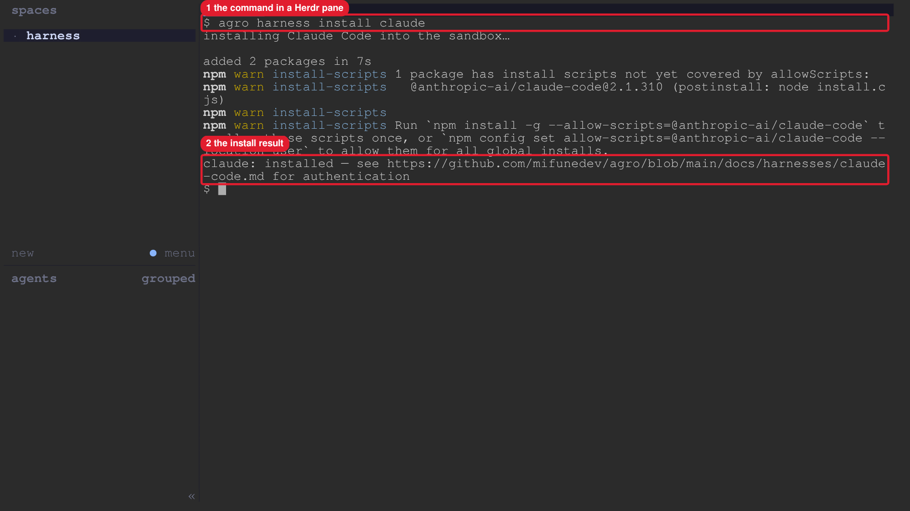

# Manual review: rename the Claude Code harness id to `claude`

The advisor ran each command in the task worktree on branch
`feat/1525-rename-claude-harness-id` at `15aa36bf`, inside the sandbox
`agro-sbx-local`. The CLI is the build from `pnpm run build:harness`, which
exited 0.

## 1. List the harnesses

```console
$ node .agro/cli/dist/agro.js harness list
HARNESS          KIND         INSTALLED
claude           installable  yes
codex            installable  yes
pi               installable  yes
opencode         installable  no
openclaw         installable  no
grok-build       installable  no
hermes           installable  no
muse-code        installable  no
antigravity-cli  installable  yes
fx               installable  no
prime-agent      installable  no
t3code           on-demand    no
[exit 0]
```

## 2. Use the deprecated alias

```console
$ node .agro/cli/dist/agro.js harness status claude-code
agro harness: "claude-code" is a deprecated alias for "claude"; the alias stops working in 0.29.0
HARNESS  KIND         INSTALLED
claude   installable  yes
[exit 0]
```

## 3. Use the canonical id

```console
$ node .agro/cli/dist/agro.js harness status claude
HARNESS  KIND         INSTALLED
claude   installable  yes
[exit 0]
```

## 4. Use an unknown name

```console
$ node .agro/cli/dist/agro.js harness install nope
agro harness: unknown harness "nope"

Known harnesses:
  claude
  codex
  pi
  opencode
  openclaw
  grok-build
  hermes
  muse-code
  antigravity-cli
  fx
  prime-agent
  t3code
[exit 1]
```

## 5. Banner hint

```console
$ grep -n 'harness install claude' .agro/install/banner.sh
76:claude_detail="not installed — run: ${cli_bin} harness install claude"
[exit 0]
```

The banner script did not run. The script renders the sandbox login banner from
sandbox state. The grep shows the hint line that the banner prints when Claude
Code is not installed.

## 6. Quickstart screenshot



`us-004-capture.md` in this folder records the capture on one temporary n4
agro-console node. The node lived about 5 minutes 29 seconds, and
`agro node delete` exited 0.
