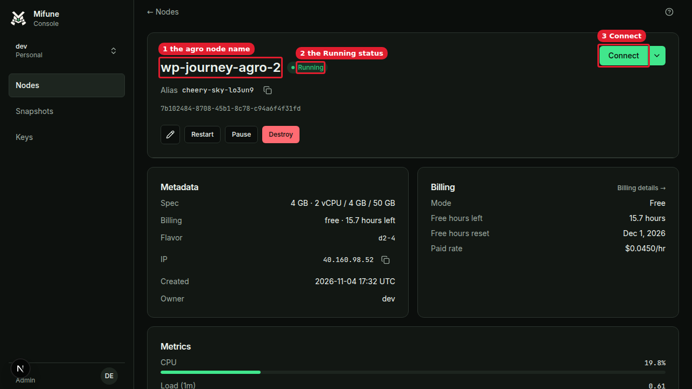
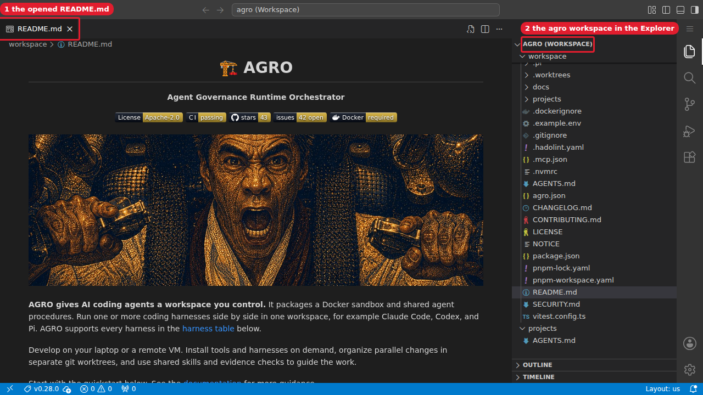
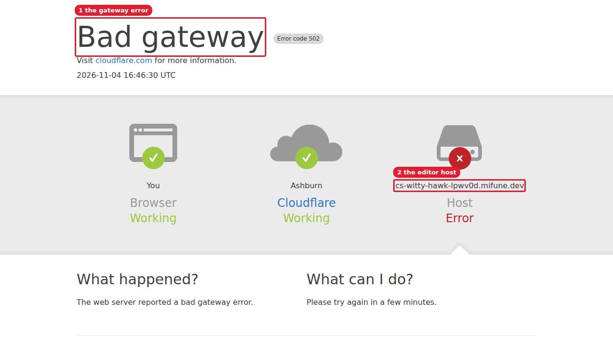
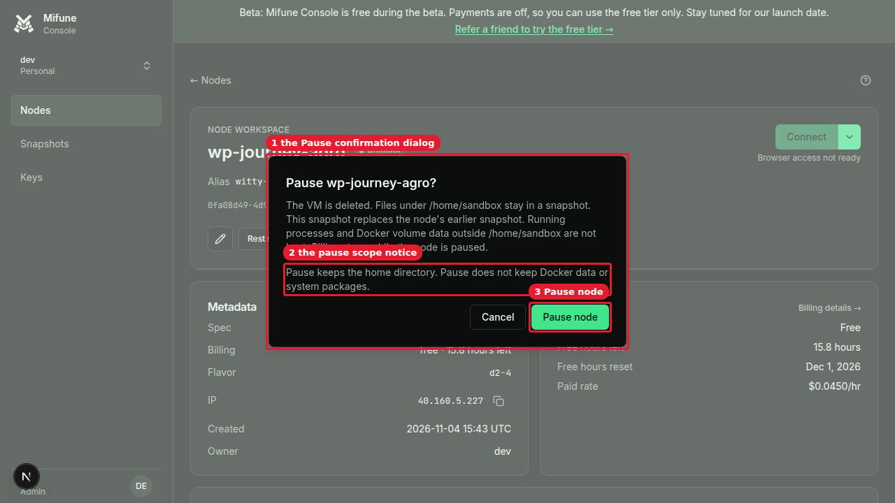
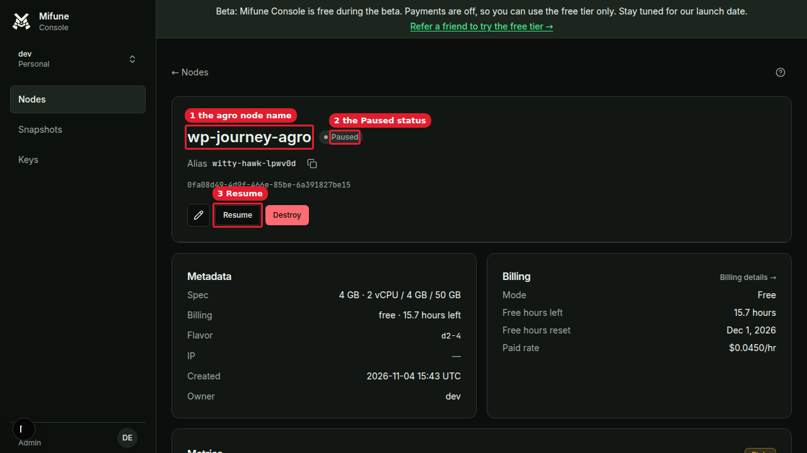
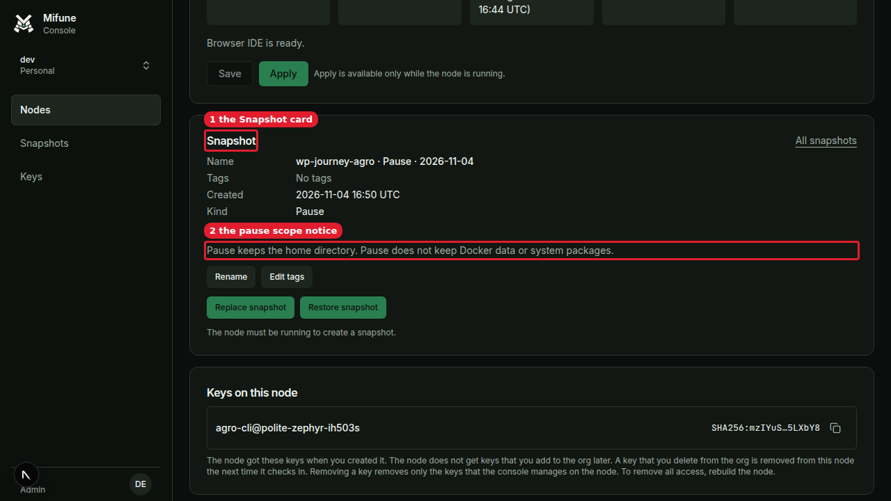
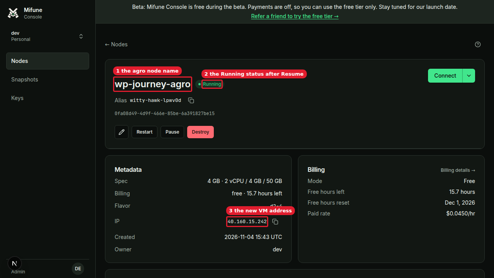
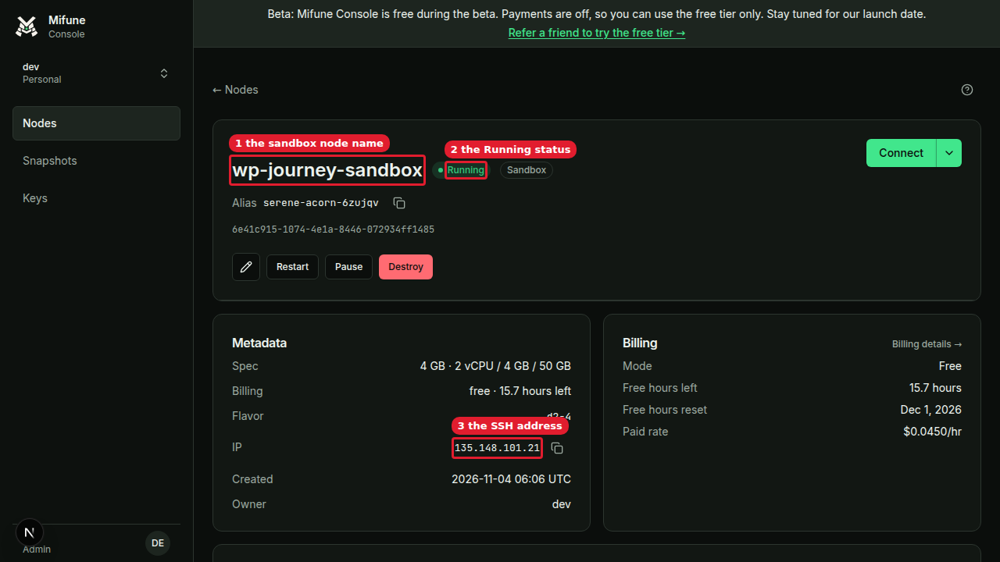

## Manual review

Screenshot paths are relative to `.agro/tasks/warm-pool-pause-protocol/evidence/`. The advisor converts each path to a `blob/<commit-sha>/<path>?raw=true` link. The observed results come from the run on 2026-11-04 (transcript: `journey/journey.md`).

**Setup (host dev environment)**

1. Run the agro-console branch `task/1557-nprime-pause-notice` at `20b522ca` on `http://localhost:3006`, with `features.pauseScopeNotice: true` and warm pools agro n4 1/1 and sandbox n4 1/1. Expected: `select profile, spec, status from nodes where status='pooled'` returns one `agro|n4|pooled` row and one `sandbox|n4|pooled` row.
2. Set `PROVISIONER_EGRESS_IP` to the current egress IP of the host (`curl https://api.ipify.org`) before the pools fill. Expected: the node file `/etc/ssh/authorized_keys/agroproxy` pins that IP in `from="<ip>/32"`.
3. Sign in at `/signin` with the Development form as `dev@agro.local`. Expected: the context switcher shows "dev Personal".

Run the scenarios in the order A, B, C, D. Keep one journey node live at a time.

**A. Create an agro node and open the editor (Step 1)**

1. Open Create node. Select Free and Agro. Turn on Browser editor (code-server), T3 Code, and Docker. Name the node `wp-journey-agro-2`. Click "Create free node". Expected: the node page shows "Running". Observed (rerun): Create click to `running` took 31.9 s, and `bootstrapping` (`reason: bind`) to `running` took 23.4 s in `node_events`.
   

Screenshot

   
   

   Callouts: 1 is the agro node name. 2 is the Running status. 3 is Connect.
2. Click "Connect". Expected: code-server opens in a new tab on `cs-<alias>.mifune.dev` with the title "agro (Workspace) - code-server" and README.md open. Observed (rerun): the Create click to the open editor took 85.4 s. Connect became enabled 29.6 s after `running`, and the editor opened 23.8 s after the Connect click.
   

Screenshot

   
   

   Callouts: 1 is the opened README.md. 2 is the agro workspace in the Explorer.
3. Failure path, from the first attempt with Setup step 2 unmet (`PROVISIONER_EGRESS_IP` still 40.160.8.140). Click "Connect". Observed: the tab showed "Bad gateway Error code 502". The node sshd refused the gateway key with `not from a permitted host (host=40.160.94.106, ... required=40.160.8.140/32)`. On that attempt, Create to `running` took 30.0 s, and bind to `running` took 26.7 s.
   

Screenshot

   
   

   Callouts: 1 is the gateway error. 2 is the editor host.

**B. Pause and resume the agro node (Step 3)**

1. Over SSH as `sandbox@<ip>`, run `docker volume create jv && docker run -d --name jc -v jv:/data busybox sh -c 'echo hi >/data/f; sleep infinity'`, then `echo journey-$(date -u +%FT%TZ) > /home/sandbox/journey-marker.txt`. Expected: `docker exec jc cat /data/f` prints "hi", and `docker ps` lists `jc`.
2. On the node page, click "Pause". Expected: the dialog "Pause wp-journey-agro?" shows "Pause keeps the home directory. Pause does not keep Docker data or system packages."
   

Screenshot

   
   

   Callouts: 1 is the Pause confirmation dialog. 2 is the pause scope notice. 3 is Pause node.
3. Click "Pause node". Expected: the node page shows "Paused" and a Resume button. Observed: `node_events` recorded `paused` 71 s after the click. `nodes.status` read `pausing` until the web process restarted about 15 minutes later.
   

Screenshot

   
   

   Callouts: 1 is the agro node name. 2 is the Paused status. 3 is Resume.
4. Scroll to the Snapshot card. Expected: the card shows Kind "Pause" and "Pause keeps the home directory. Pause does not keep Docker data or system packages."
   

Screenshot

   
   

   Callouts: 1 is the Snapshot card. 2 is the pause scope notice.
5. Click "Resume", then "Resume node". Expected: the node page shows "Running" with a new IP. Observed: Resume click to `running` took 60.5 s, and `resuming` to `running` took 49.6 s.
   

Screenshot

   
   

   Callouts: 1 is the agro node name. 2 is the Running status after Resume. 3 is the new VM address.
6. Over SSH on the new IP, run `docker ps -a`, `docker inspect jc`, `docker volume inspect jv`, and `cat /home/sandbox/journey-marker.txt`. Expected under pause default A: `docker ps -a` lists nothing, `docker inspect jc` exits 1, `docker volume inspect jv` exits 1, and the marker prints "journey-2026-11-04T16:49:42Z" with exit 0.
7. Click "Destroy", then "Destroy node". Expected: `nodes.status` becomes `destroyed`.

**C. Create a sandbox node (Step 2)**

1. Open Create node. Select Free and Sandbox, keep Docker on, and name the node `wp-journey-sandbox`. Click "Create free node". Expected: the node page shows "Running" with the "Sandbox" badge. Observed: Create click to `running` took 14.9 s, and bind to `running` took 10.0 s.
   

Screenshot

   
   

   Callouts: 1 is the sandbox node name. 2 is the Running status. 3 is the SSH address.
2. Over SSH as `sandbox@<ip>`, run `docker info` and `command -v agro`. Expected: `docker info` exits 0 (server version "29.9.3"), and `command -v agro` prints nothing and exits 1.
3. Click "Destroy", then "Destroy node". Expected: `nodes.status` becomes `destroyed`.

**D. Warm pool state under N′ (Step 4)**

US-009 picked N′, so the H check "one pool for each spec" does not apply. This scenario has no screenshot. The database is the source.

1. On the host, run `docker exec postgres psql -U postgres -d agro_console_dev -At -c "select profile, spec, status, pooled_at from nodes where status='pooled'"`. Expected: two rows, one `agro|n4|pooled` and one `sandbox|n4|pooled`. Observed at 17:45:41: `agro|n4|pooled|2026-11-04 17:45:37.067+00` (`e168d641`) and `sandbox|n4|pooled|2026-11-04 17:39:16.452+00` (`cfc3e4aa`). Before the egress pin fix, the sandbox refill `830d26ad` failed with `READY_TIMEOUT: the node did not register within 15 minutes after waiting_for_boot` (17:26:56). The pools refilled after the provisioner restart.

**E. Cleanup**

1. Run `AGRO_CONSOLE_URL=http://127.0.0.1:3006 agro node list --json`. Expected: exit 0, and no node has a status other than `destroyed`. Observed at 17:46: exit 0, 184 nodes, 0 live.
