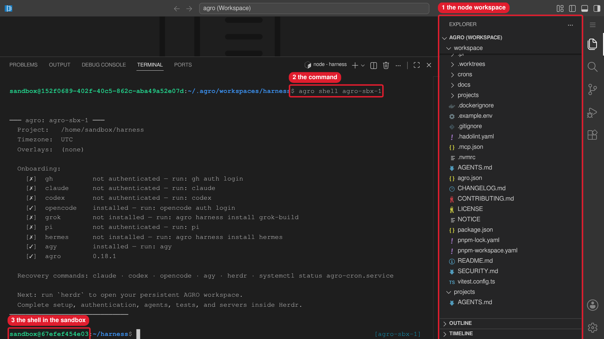

# Connecting to the Sandbox

The sandbox is a Docker container on your host or on a remote server. This page
owns remote access: the terminal, VS Code attach, direct SSH, Tailscale, and
tunnels. Not every connection method forwards ports. Pick the method that
matches what you must reach.

## Ways to connect

| Option | Command or action | Port forwarding to your laptop |
|--------|-------------------|--------------------------------|
| **A — Terminal** | `agro shell <name>` on the host | None |
| **B — VS Code Attach (local host)** | Dev Containers → *Attach to Running Container* → your sandbox | Automatic while attached |
| **C — VS Code Remote-SSH + Attach (remote host)** | Remote-SSH to the host, then Option B | Automatic while attached |
| **D — Direct SSH (opt-in)** | `ssh -p 2222 sandbox@localhost` after you enable SSH | None |

Inside the sandbox, first run `agro tool install herdr`. Next, run `herdr`. Run
agents, tests, and development servers in Herdr panes.

### Option A — Terminal

```bash
agro shell <name>
```


Callouts: 1 is the node workspace in the **Explorer**. 2 is the command. 3 is the shell in the sandbox.

`agro shell` attaches as the `sandbox` user. `agro sandbox list` prints the
names. If the target container has no `sandbox` user, run
`docker exec -it -u <user> <container> zsh`.

Option A forwards no ports. You cannot open `localhost:3000` in your laptop
browser through this option alone.

> **Attach. Do not use "Reopen in Container".** *Dev Containers: Reopen in
> Container* reads `.devcontainer/devcontainer.json`, which names only
> `docker-compose.yml`. It bypasses `.agro/scripts/docker-compose.sh` and applies
> no compose overlays: no SSH, no host Docker socket, and no `composeOverrides`
> entry. Create the sandbox with `agro sandbox install docker`, then attach.
> Details:
> [lifecycle commands](lifecycle-commands.md#vs-code-reopen-in-container-applies-no-overlays).

### Option B — VS Code Attach to Running Container (local host)

1. Install the [Dev Containers](https://marketplace.visualstudio.com/items?itemName=ms-vscode-remote.remote-containers) extension.
2. Open the Command Palette (`Ctrl+Shift+P` / `Cmd+Shift+P`).
3. Run **Dev Containers: Attach to Running Container**.
4. Select your sandbox. `agro sandbox list` prints the names.

VS Code forwards container ports to `localhost` on your laptop while the window
stays attached. The **Ports** panel lists each forward. After you close or
detach the window, the forwards stop. Processes in the sandbox keep running.

### Option C — VS Code Remote-SSH + Attach (remote host)

1. Connect to the server with **Remote-SSH** in VS Code.
2. From that window, follow Option B.

VS Code tunnels the container ports through the SSH connection to your laptop.
You need no manual `ssh -L`.

### Option D — Direct SSH (opt-in)

The base container runs no SSH daemon. Enable SSH, then connect from the host:

```bash
ssh -p 2222 sandbox@localhost
```

SSH uses public-key auth by default and binds only to host loopback. Setup, key
configuration, the port-collision preflight, and multi-tenant nginx routing are
in [SSH](integrations/sshd.md).

## Default exposure

The base sandbox publishes no application ports to the host. Your laptop reaches
a container port only through one of these:

- VS Code auto-forwarding (Options B and C);
- a manual `ssh -L` tunnel to the host;
- a compose overlay that you add;
- Tailscale Serve inside the sandbox;
- a public tunnel such as `cloudflared`.

## Opt-in exposure

### Compose overlay

Write an overlay that publishes the port, then add its absolute path to
`composeOverrides` in the sandbox `agro.json`:

```yaml
# /srv/agro/docker-compose.expose.yml
services:
  sandbox:
    ports:
      - "0.0.0.0:3000:3000"
```

```bash
agro config set composeOverrides /srv/agro/docker-compose.expose.yml --sandbox <name>
agro stop <name> && agro sandbox install docker --name <name>
```

A `0.0.0.0` bind exposes the port on every host interface, including a public
one. Use `127.0.0.1` when only the host must reach it. Field reference:
[Configuration → Compose overlays](configuration.md#compose-overlays).

### Public tunnel

For public access, use `cloudflared` (see the `/cloudflared` skill), `ngrok`, or
an nginx or Caddy reverse proxy. Start the tunnel inside the sandbox in a named
tmux session. The URL is the only credential. Anyone who has the URL reaches the
port. For private access from your own devices, use
[Tailscale](#mobile-access-over-tailscale) instead.

## Mobile access over Tailscale

Tailscale is the supported path to reach T3 Code from a phone, or from any device
when the sandbox runs on a remote host. Access stays private to your tailnet.

`tailscaled` runs inside the sandbox in userspace-networking mode, as the
`sandbox` user. The container is the tailnet node:

- The sandbox needs no `NET_ADMIN`, no `/dev/net/tun`, and no compose change.
- The host publishes no port. T3 Code listens on container loopback
  `127.0.0.1:3773`. Tailscale Serve proxies tailnet HTTPS to that address.
- Node state lives in `/home/sandbox/.tailscale`, inside the home mount. The node
  keeps its identity across a container recreate and a move to another VM.
- Nothing installs Tailscale at boot, and nothing joins a tailnet for you.

### Prerequisites

- The sandbox runs (`agro ps <name>`).
- Sandbox Node satisfies the T3 Code range `^22.16 || ^23.11 || >=24.10`
  (`node -v`).
- A provider is authenticated in the sandbox.
- You control a tailnet.
- The phone has the Tailscale app, signed in to the same tailnet, and the T3 Code
  app.

### Steps

1. Start T3 Code in the sandbox:

   ```text
   /t3 start
   ```

   The skill runs `npx --yes t3@latest serve` in the `agent-t3code` tmux session.
   T3 Code listens on `127.0.0.1:3773`.

2. Enable phone access:

   ```bash
   agro tool setup t3-mobile enable
   ```

   The verb installs Tailscale when Tailscale is missing. The verb starts `tailscaled` in
   the tmux session `agent-tailscaled`, so the daemon survives a disconnect. The
   verb then runs these commands in order and stops at the first failure:
   1. `tailscale up`. This command prints a login URL. Open the URL and approve
      the node.
   2. `tailscale serve --bg --https=443 http://127.0.0.1:3773`. Serve proxies
      tailnet HTTPS to T3 Code.
   3. `t3 pair --tailscale`, or `npx --yes t3@latest pair --tailscale` when `t3`
      is not on `PATH`. This command prints a QR code and the `ts.net` pairing
      URL.

   Never commit a reusable Tailscale auth key. Never print one into a log or a
   tracked file.

3. Pair the phone. Scan the QR code, or paste the
   `https://<machine>.<tailnet>.ts.net/...` URL into the T3 Code app.

The pairing token is single-use. The paired session persists. To add another
device, do not restart the server. Run the next command and pair with the new
URL:

```bash
agro tool setup t3-mobile pair
```

To show the tailnet state and the Serve mapping, run
`agro tool setup t3-mobile status`. To update T3 Code, run `t3 update`.

### Lifecycle

| tmux session | Process |
|--------------|---------|
| `agent-tailscaled` | the Tailscale daemon |
| `agent-t3code` | `npx --yes t3@latest serve` |

Both sessions survive a disconnect. `/t3 status` and `/t3 logs` read the T3
session without an attach. After a container recreate, the daemon is not
running: repeat steps 1 and 2. `tailscale up` asks for a login again only after
a logout.

### Revoke access

T3 pairing and tailnet access are separate. Revoke both:

```bash
t3 auth                            # inspect and revoke T3 sessions and pairing credentials
agro tool setup t3-mobile disable  # remove the Serve mapping; it persists until you do
tailscale logout                   # sign the sandbox node out of the tailnet
```

Then delete the device in the Tailscale admin console.

### Rename the node

A rename of the Tailscale node does not move the Serve mapping. The mapping
stays on the old MagicDNS name. Run these commands in the sandbox to remove the
old mapping and publish T3 Code on the new name:

```bash
tailscale serve reset
agro tool setup t3-mobile enable
```

### Troubleshooting

`/t3 doctor` runs the Node and tooling checks and prints one line per failure.
`agro tool setup t3-mobile status` prints the tailnet state and the Serve
mapping.

| Symptom | Cause | Fix |
|---------|-------|-----|
| `tailscale status` cannot reach the daemon | `tailscaled` not running | run `agro tool setup t3-mobile enable` again; check `tmux ls` for `agent-tailscaled` |
| Backend state is not `Running` | node never joined, or logged out | run `agro tool setup t3-mobile enable`, then complete the browser login |
| No `ts.net` URL in the pair output | Serve not configured | run `agro tool setup t3-mobile status`; then run `agro tool setup t3-mobile enable` |
| Serve answers after T3 Code stops | the Serve mapping persists | `agro tool setup t3-mobile disable` |
| T3 Code fails with an engine error | Node outside `^22.16 \|\| ^23.11 \|\| >=24.10` | check `node -v`; rebuild the sandbox on Node 24.10 or later |
| Phone cannot reach the URL | phone not on the tailnet | sign the phone in to the same tailnet; confirm it in `tailscale status` |
| Phone on the tailnet, URL times out | Serve on another port, or server stopped | `agro tool setup t3-mobile status`; `/t3 status` |
| `https://app.t3.codes` cannot connect | mixed content: an HTTPS page blocks a plain-HTTP endpoint | use the `ts.net` HTTPS URL or the native app |

AGRO never enables Tailscale Funnel and ships no Funnel command. For a public
preview, use `/cloudflared 3773` instead.

## tmux session names

Herdr holds interactive work. Headless services run in named tmux sessions with
the pattern `<category>-<identifier>`:

| Category | Examples | Purpose |
|----------|----------|---------|
| `client-` | `client-slack-pi`, `client-slack-hermes` | Messaging gateways ([Slack](integrations/slack.md)) |
| `agent-` | `agent-t3code`, `agent-tailscaled` | Headless agent services and daemons |
| `app-` | `app-hermes-dashboard` | Headless application servers |

Full convention:
[`.agro/skills/t3/references/sandbox-processes.md`](../.agro/skills/t3/references/sandbox-processes.md).

## Reach T3 Code

T3 Code listens on container port 3773. With VS Code attached, open
`http://localhost:3773`. Over Tailscale Serve, open
`https://<machine>.<tailnet>.ts.net/`. Start T3 Code with `/t3 start`. Next,
open the pairing URL from `/t3 url`. More: [T3 Code](harnesses/t3code.md).
